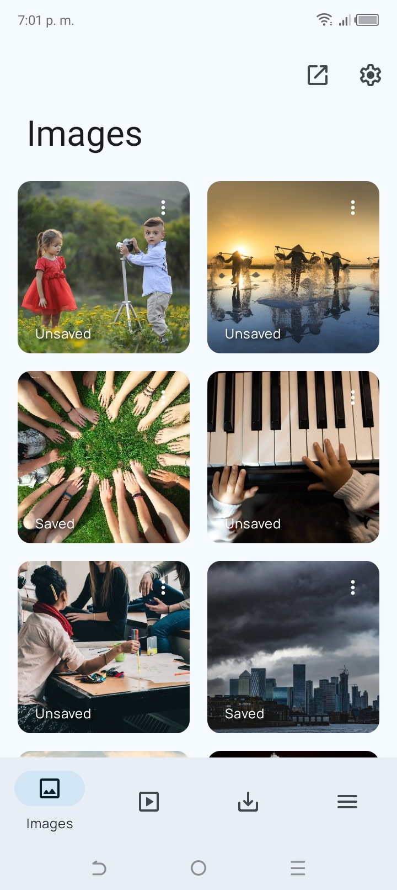
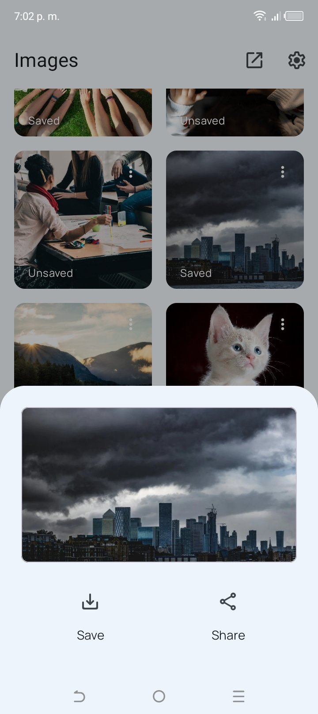
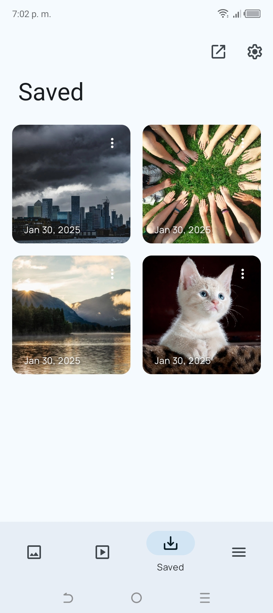
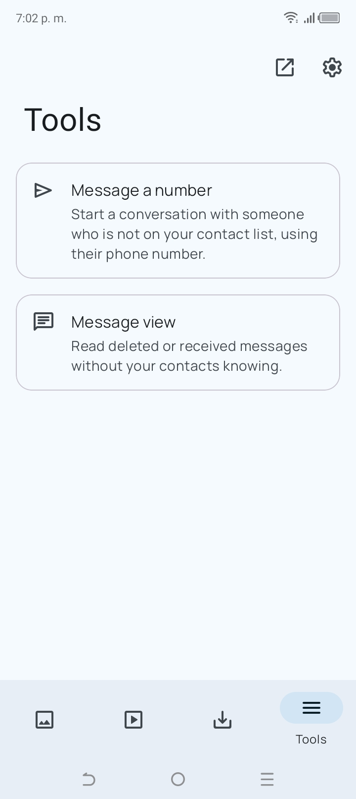
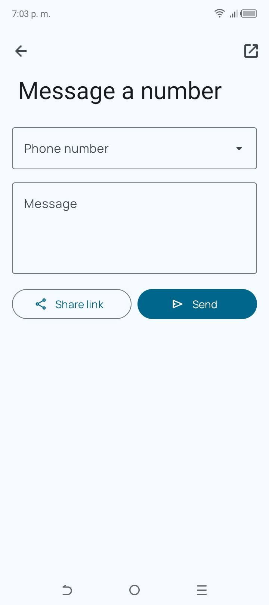
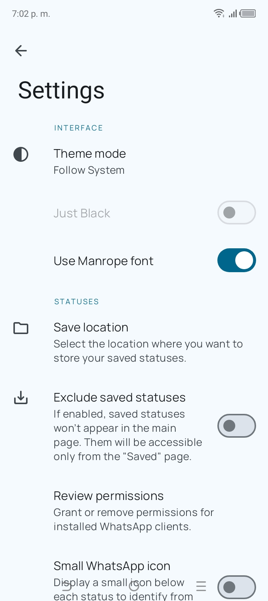

<div align="center">

# WhatStash

### Una app de código abierto y respetuosa con tu privacidad para guardar estados de WhatsApp y WhatsApp Business.

[English](README.md)
&nbsp;&nbsp;|&nbsp;&nbsp;
Español

[](LICENSE.md)
[](https://github.com/strider-ape/WhatStash)
[](https://github.com/strider-ape/WhatStash/releases/latest)
[](CODE_OF_CONDUCT.md)

</div>

> [!NOTE]
> WhatStash es la continuación de **[WhatSave](#créditos)** de Christians Martínez A., cuyo repositorio
> original y ficha en F-Droid ya no están disponibles. Estamos cambiando su marca y modernizándolo.
> Ya está disponible la versión 1.0.0. Consulta el [plan del proyecto (en inglés)](docs/PLAN.md) para ver lo que viene.

## Capturas

<div align="center">
<div>






</div>

<sub>Las capturas son de WhatSave 2.x, el código del que parte WhatStash. Habrá nuevas tras el cambio de marca.</sub>
</div>

## Objetivos

* **Sin publicidad, sin rastreo, sin cuentas** y sin el permiso `INTERNET`
* **Distribución solo en canales de código abierto:** GitHub Releases, IzzyOnDroid y F-Droid (no Google Play)
* **Aparece junto a WhatsApp** en el cajón de aplicaciones
* Honestidad sobre lo posible: WhatsApp no guarda en el archivo quién publicó un estado, así que ninguna app puede filtrar estados por contacto

## Características

Heredadas de WhatSave:

* Estados de WhatsApp y WhatsApp Business (imágenes y videos)
* Vista previa con visor de imágenes y reproductor de video (con velocidad de reproducción)
* Guardar, compartir y selección múltiple
* Chatear con un número sin guardarlo como contacto
* Recuperar mensajes eliminados (opcional, guardados solo en tu dispositivo)
* Material You en Android 12+, modo nocturno y tema negro
* Compatible con Android 7.0 Nougat y superiores
* Sin marca de agua, gratis para siempre

Previstas para WhatStash ([detalles](docs/PLAN.md)):

* Cuenta regresiva de caducidad en cada estado
* Detección de duplicados y marca de "ya guardado"
* Volver a publicar un estado directamente en WhatsApp
* Guardar un fotograma de un video como foto
* Guardado automático opcional, avisos de estados nuevos, widget y acceso en Ajustes rápidos
* Bloqueo de la app, ocultar los guardados de la galería, copia de seguridad y exportación

## Descargar

Descarga el APK más reciente desde [GitHub Releases](https://github.com/strider-ape/WhatStash/releases/latest).
Está previsto publicarlo en IzzyOnDroid y F-Droid.

Los APK publicados están firmados con este certificado (SHA-256), para que puedas comprobar que un APK es auténtico:

```
5F:EC:87:12:B5:49:AA:7B:14:7A:27:3D:41:A4:27:85:A0:5C:D9:50:1B:6E:29:50:22:5C:C0:16:B9:FC:9D:7A
```

## Compilar

```bash
git clone https://github.com/strider-ape/WhatStash.git
cd WhatStash
./gradlew assembleDebug
```

Requiere JDK 21. No hacen falta claves de firma ni archivos de servicios de Google. Sin un archivo
`keystore.properties`, las compilaciones de lanzamiento se firman con la clave de depuración.

## Contribuciones

Se agradecen issues y pull requests. Consulta [CONTRIBUTING (en inglés)](CONTRIBUTING.md) y el
[plan del proyecto](docs/PLAN.md) para ver en qué se está trabajando.

## Privacidad

WhatStash solo lee los archivos de estados que WhatsApp ya guardó en tu dispositivo, a través de una carpeta
a la que tú das acceso. No tiene permiso de internet, analítica ni comprobador de actualizaciones.
Consulta [PRIVACY (en inglés)](PRIVACY.md).

## Créditos

WhatStash se basa en **WhatSave**, creado por **Christians Martínez A.**
([@mardous](https://github.com/mardous)). Casi todo el código de este repositorio es obra suya, y aquí se
conserva su historial completo de commits. Gracias por crearlo y publicarlo como software libre.

Gracias también a todas las personas que tradujeron WhatSave en Hosted Weblate.

## Licencia

WhatStash está licenciado bajo la [Licencia Pública General de GNU, Versión 3.0](LICENSE.md), la misma
licencia que WhatSave. Los avisos de copyright originales se mantienen en el código. Cualquier proyecto
derivado debe mantener esta misma licencia.

## Aclaración

WhatStash no está afiliado, respaldado ni relacionado con WhatsApp ni con Meta Platforms, Inc.
WhatsApp es una marca registrada de su respectivo propietario.
