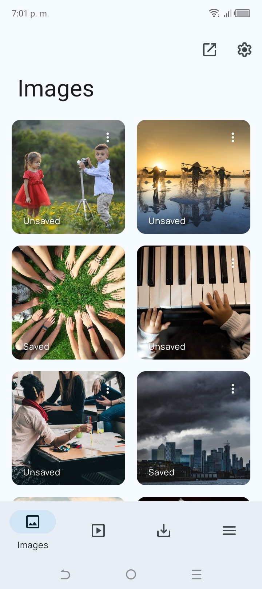
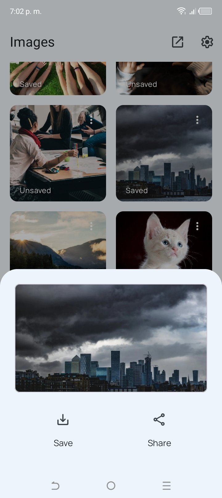
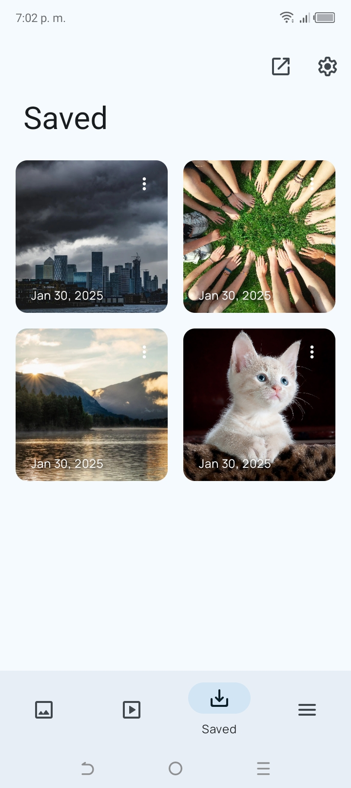
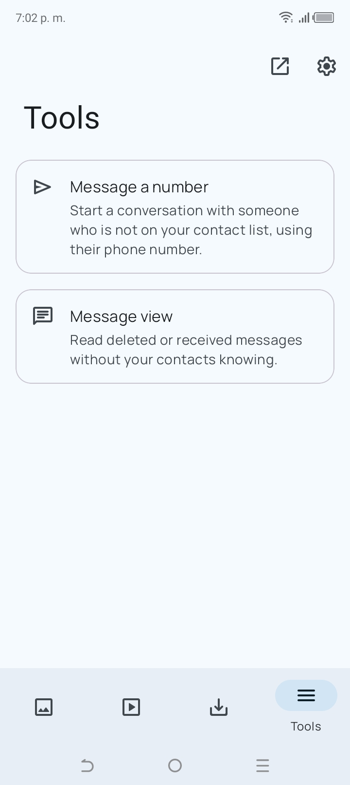
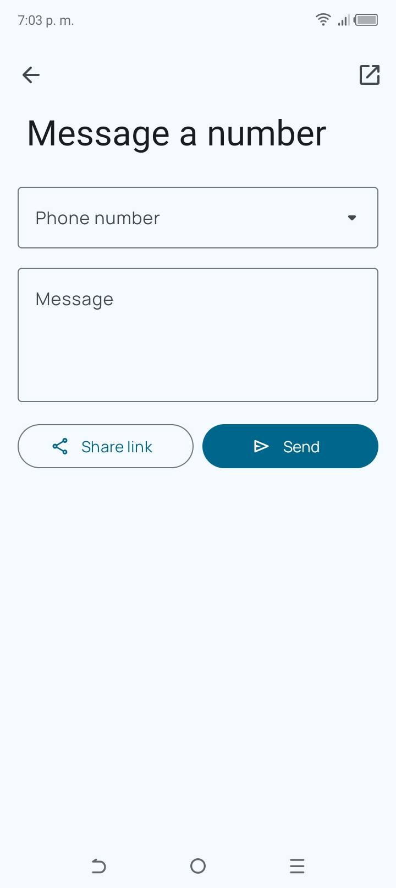
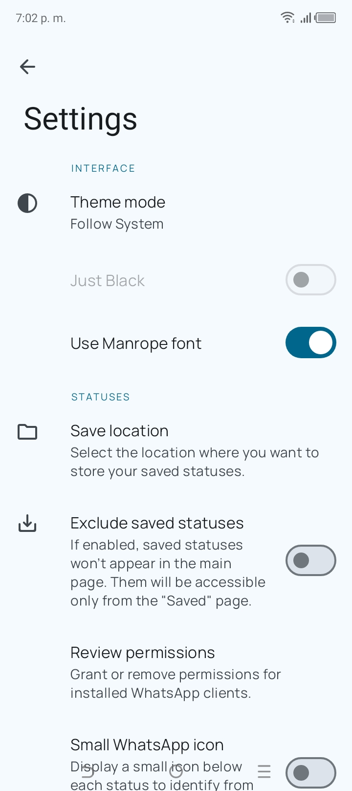

<div align="center">

# WhatStash

### A privacy-first, open-source app to save WhatsApp & WhatsApp Business statuses.

English
&nbsp;&nbsp;|&nbsp;&nbsp;
[Español](README-es.md)

[](LICENSE.md)
[](https://github.com/strider-ape/WhatStash)
[](docs/PLAN.md)
[](CODE_OF_CONDUCT.md)

</div>

> [!NOTE]
> WhatStash is a continuation of **[WhatSave](#-credits)** by Christians Martínez A., whose original
> repository and F-Droid listing are no longer available. We are rebranding and modernizing it.
> There is no release yet — see the [project plan](docs/PLAN.md) for where things stand.

## 📱 Screenshots

<div align="center">
<div>






</div>

<sub>Screenshots are from WhatSave 2.x, the codebase WhatStash starts from. New ones will follow the rebrand.</sub>
</div>

## 🎯 Goals

* **No ads, no tracking, no accounts** — and ultimately no `INTERNET` permission at all
* **Open-source distribution only:** GitHub Releases, IzzyOnDroid and F-Droid (no Google Play)
* **Sits next to WhatsApp** in your app drawer
* Honest about what is possible: WhatsApp doesn't record who posted a status in the file, so no app can filter statuses by contact

## 📃 Features

Inherited from WhatSave:

* WhatsApp and WhatsApp Business statuses (images and videos)
* Preview with a built-in image viewer and video player (with playback speed)
* Save, share and multi-select
* Chat with a number without saving it as a contact
* Recover deleted messages (opt-in, stored only on your device)
* Material You on Android 12+, night mode and black theme
* Supports Android 7.0 Nougat and newer
* No watermark, free forever

Planned for WhatStash ([details](docs/PLAN.md)):

* Expiry countdown on every status
* Duplicate detection and an "already saved" badge
* Repost a status straight to WhatsApp
* Save a frame from a video as a photo
* Optional auto-save, new-status notifications, home-screen widget and Quick Settings tile
* App lock, hide saved files from the gallery, backup and export

## ⬇️ Download

No release yet. Once ready, WhatStash will be published on
[GitHub Releases](https://github.com/strider-ape/WhatStash/releases), then IzzyOnDroid and F-Droid.

## 🛠️ Building

```bash
git clone https://github.com/strider-ape/WhatStash.git
cd WhatStash
./gradlew assembleFdroidDebug
```

No signing keys or Google services files are needed for debug builds.

## 🤝 Contributing

Issues and pull requests are welcome. See [CONTRIBUTING](CONTRIBUTING.md) and the [project plan](docs/PLAN.md)
for what is being worked on.

## 🔏 Privacy

WhatStash only reads the status files WhatsApp has already stored on your device, through a folder you
grant access to. The analytics and update checker inherited from WhatSave are being removed; until that is
done, see [PRIVACY](PRIVACY.md) for the original policy.

## 🙏 Credits

WhatStash is based on **WhatSave**, created by **Christians Martínez A.**
([@mardous](https://github.com/mardous)). Almost all of the code in this repository is his work, and the
full commit history is preserved here. Thank you for building it and releasing it as free software.

Thanks also to everyone who translated WhatSave through Hosted Weblate.

## ⚖️ License

WhatStash is licensed under the [GNU General Public License, Version 3.0](LICENSE.md), the same license as
WhatSave. Original copyright notices are kept in the source files. Any fork must keep the same license.

## ⚠️ Disclaimer

WhatStash is not affiliated with, endorsed by, or connected to WhatsApp or Meta Platforms, Inc.
WhatsApp is a trademark of its respective owner.
